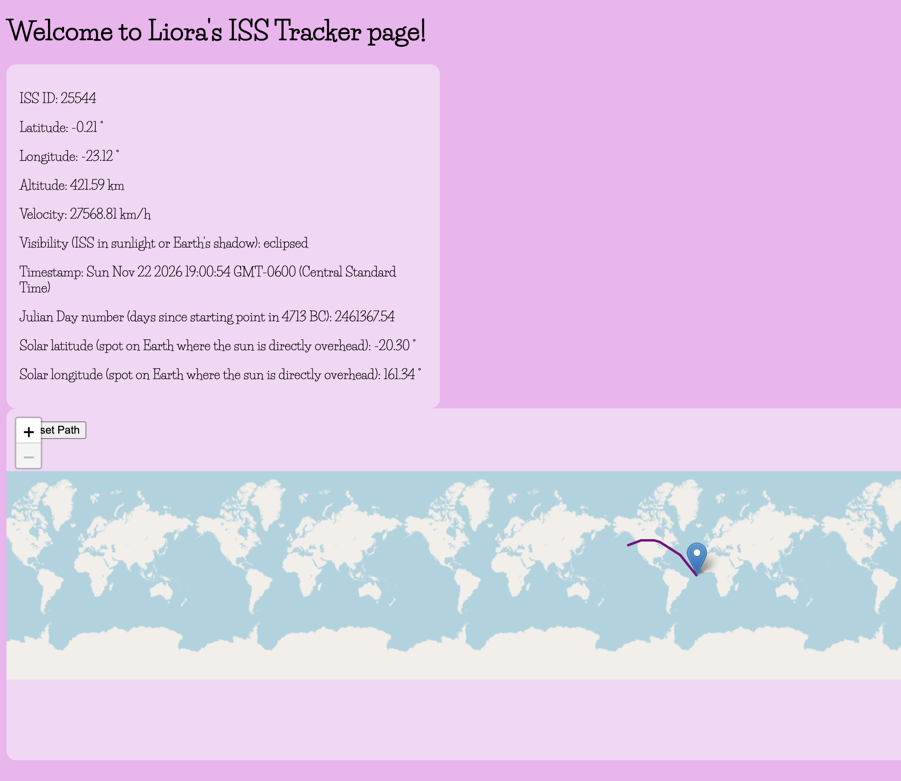

# International Space Station Tracker
A real-time ISS tracker I built to learn how APIs work! Ever wondered where the International Space Station is right now? This tracker pulls its live position every 3 seconds and follows it across a world map, leaving a trail of its path.

## Live demo
[See the ISS live->](https://liorak912.github.io/Iss-tracker/ )

## Features
- Live ISS stats: position, altitude, speed and whether it's in sunlight or Earth's shadow, updated every 3 seconds
- Interactive world map showing where the ISS is right now
- Path trail that traces its orbit as you watch
- Reset button to clear the trail and restart the path
## Built with
- Javascript,HTML, CSS
- wheretheiss.at API for live ISS data
- OpenStreetMap for the map tiles
- GitHub Pages for hosting

## Coming soon
- speed comparisons calculated live
- What's the ISS flying over right now?
- About ISS fun facts